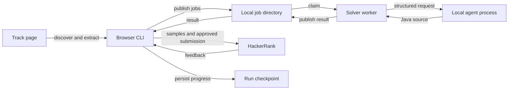

# Requirements

### Feasibility and scope

Yes: Selenium can discover challenges, extract their statements and Java templates, populate the editor, run samples,
and submit solutions generated by a local agent. Reliability depends on HackerRank's current UI and the agent's
capabilities; solving every challenge is not guaranteed.

Build a Java-first practice bot with a **separate solver worker**, processing accessible challenges discovered from a
supplied Java-track URL. No direct AI API integration in the initial version.

### Expected behavior
- Open a visible browser; pause for user-assisted login, CAPTCHA, or other access checks. Never bypass those checks.
- Discover track challenges across pagination or lazy loading, preserve discovery order, and deduplicate by stable
  challenge identity.
- Extract statement, constraints, input/output format, examples, selected Java variant, and starter code, preserving
  required class names and method signatures.
- Send a structured job to the worker, which invokes a configurable local agent command and returns Java source.
- Insert the solution, run platform samples, and capture compilation/runtime/test feedback.
- Default to `--approval required`; support `--approval automatic` for unattended submission after samples pass.
  Approval rejection skips the challenge without submitting.
- Default to `--max-attempts 3`, configurable to 2 or 3. Feed available failure details into the next attempt; skip
  exhausted or unsupported challenges and continue the sequence.
- Checkpoint progress and produce a per-challenge summary with accepted, skipped, exhausted, and unresolved outcomes.
  Sample success is not equivalent to acceptance.

### Boundaries

Practice use only, subject to platform rules: no contests, hiring assessments, access-control bypass, or anti-detection
mechanisms. Respect access blocks and throttling; pause instead of repeatedly hammering the site.

No initial multi-language support, cloud workers, automatic account creation, or guarantee of full track coverage. Java
solutions are tested through HackerRank; do not add an unsandboxed local execution engine for generated code.

# Technical Design

### Repository baseline
- `README.md` contains only the project title; no application or analogous implementation exists.
- `.tool-versions` specifies Java `temurin-25` and Maven `3.9.9`, plus Node 22. Use Java/Maven for both application
  roles; generated code must target the Java runtime offered by HackerRank, not assume Java 25.
- `skills.sh:11–26` installs development skills; it is not a solver integration and remains unchanged.
- `.gitignore` excludes `.idea/`, `.agents/skills/`, and `.agents/skills-lock.json`; add exclusions for build output,
  browser profiles, checkpoints, job artifacts, and secrets.

### Components and files

Add `pom.xml` and standard Maven `src/main/java` and `src/test/java` layouts under package `io42630.rankbot`:
- `cli/BrowserCommand.java`, `cli/WorkerCommand.java`: separate browser and worker entry points, configuration
  validation, clean shutdown.
- `browser/HackerRankSession.java`, `TrackPage.java`, `ChallengePage.java`, `CodeEditor.java`: Selenium page objects
  with explicit waits and centralized selectors; manual login handoff, discovery, extraction, editor interaction,
  samples, submission, and verdict retrieval.
- `jobs/JobStore.java`, `JobContracts.java`: filesystem job protocol and atomic lifecycle transitions.
- `solver/LocalAgentRunner.java`: configurable subprocess invocation, timeout, result validation, bounded output
  capture.
- `workflow/ChallengeRunner.java`, `RunCheckpoint.java`: sequencing, approval, retries, resumability, and summaries.
- Add a secret-free example configuration and expand `README.md` with browser/worker startup, local-agent adapter
  requirements, and practice-only limitations.

### Architecture

Use one browser process and one worker initially, with one active challenge at a time. No message broker or network
service is needed. The processes share a local filesystem, not a network-mounted queue.

### Job contract

Versioned JSON request fields: `schemaVersion`, `jobId`, `runId`, `challengeId`, `attempt`, `language`, `statement`,
`starterCode`, `previousFeedback`, and `deadline`.

Result fields: `schemaVersion`, `jobId`, `status`, `sourceCode`, and `diagnostic`. Require matching identity and schema,
bounded payload sizes, nonempty Java source for successful results, and no Markdown fences.

Publish complete requests/results via temporary files and atomic rename. Claim pending jobs atomically; record
lease/heartbeat information and terminal failure or timeout. Ignore stale results from expired attempts. A crashed
worker consumes its recorded attempt rather than allowing unlimited regeneration.

The local-agent adapter launches an explicit executable and argument list via `ProcessBuilder`, without shell
interpolation. Supply input through a documented per-job request file and require a documented result file; adapt an
existing agent CLI through configuration or a wrapper. Capture logs separately from machine-readable output. No
particular agent command is assumed to exist.

### Workflow and recovery

Checkpoint a discovered queue, current attempt, and transitions such as `DISCOVERED`, `SOLVING`, `TESTING`,
`AWAITING_APPROVAL`, `SUBMITTING`, `ACCEPTED`, and `SKIPPED`. Persist an attempt before launching the solver. Retry
solver failures, sample failures, and unsuccessful submissions within the same total attempt budget.

Resume terminal challenges without repeating work. If interrupted during submission, reconcile visible submission
history/status before retrying; pause for manual resolution when acceptance cannot be determined. Never blindly resubmit
after a timeout.

Use editor-native integration where detectable, with Selenium keyboard/paste fallback; verify the resulting editor
contents before running samples. Preserve starter contracts and Java version constraints. Do not assume live selectors
or editor APIs until inspected during implementation.

### Risks and safeguards
- UI changes, lazy loading, truncated statements, and editor incompatibility: explicit extraction checks, centralized
  selectors, bounded waits, and diagnostic screenshots with sensitive-data precautions.
- Login/session expiry: dedicated local browser profile, manual handoff, and no credential or cookie logging.
- Untrusted challenge content and generated code: treat statement text as data; give the worker only its scratch
  directory and limited environment. A subprocess is **not** a security sandbox; document running the local agent in a
  restricted environment and never pass browser credentials to it.
- Rate limits and uncertain verdicts: stop or pause on access restrictions, use conservative delays, and distinguish
  pending/unknown verdicts from failure.

# Tickets

### Backlog status and location

Approved twelve-ticket breakdown, including granularity and blockers. Standalone ticket files are in
`.agents/issues/java-hackerrank-agent-bot/`; the skill artifacts under `.agents/` are ignored, but these ticket files
are not. Ticket files plan implementation and do not implement it.

All tickets inherit the Requirements and Technical Design above: Java-first practice use, separate local worker, local
filesystem exchange, no CAPTCHA bypass, no assessed competitions, no direct AI API, and no local execution of generated
code. Tests and relevant documentation belong in each slice.

### T1 — Launch CLI roles and exchange validated jobs

Outcome: Java/Maven browser and worker commands can publish, claim, and return a structured job without invoking an
agent.
Blocked by: None.
- [ ] `pom.xml`, CLI configuration, `JobContracts`, and `JobStore` support a versioned request/result round-trip in
  temporary-directory tests.
- [ ] Atomic publishing and claiming prevent partial reads and duplicate claims; invalid schema, identities, oversized
  payloads, and empty/fenced successful source are rejected.
- [ ] Invalid configuration fails clearly; secret-free configuration and runtime-data exclusions are documented.

### T2 — Solve one job through a local-agent subprocess

Outcome: `WorkerCommand` and `LocalAgentRunner` return validated Java source or bounded failure for a claimed job.
Blocked by: T1 supplies the executable worker and validated exchange protocol.
- [ ] A fake agent receives statement, starter code, platform Java version, deadline, and previous feedback through a
  request file and produces a validated result file.
- [ ] Explicit executable/arguments avoid shell interpolation; malformed/missing output, nonzero exit, and hangs produce
  terminal results with bounded logs and process cleanup.
- [ ] The documented adapter uses a job scratch directory and limited environment without browser credentials;
  documentation states that this is not a security sandbox.

### T3 — Recover abandoned worker jobs safely

Outcome: Worker jobs have bounded leases and cannot publish authoritative results after expiry.
Blocked by: T2 supplies the worker lifecycle and subprocess cleanup.
- [ ] Heartbeats maintain active leases; worker termination or missed heartbeat produces a bounded terminal outcome.
- [ ] Crash/timeout tests reject late or mismatched results and prevent an expired attempt from being reclaimed
  indefinitely.

### T4 — Open a browser with manual authentication handoff

Outcome: `HackerRankSession` opens a visible browser and can resume after user-assisted authentication.
Blocked by: T1 supplies browser CLI configuration and startup.
- [ ] Local fixtures verify authenticated navigation, manual-login handoff, session-expiry pause, and clean shutdown.
- [ ] CAPTCHA, access restrictions, and throttling pause rather than trigger bypass or aggressive retries; profile data
  and diagnostics do not expose credentials or cookies.

### T5 — Discover an ordered Java-track challenge queue

Outcome: `TrackPage` produces stable, deduplicated challenge identities from a supplied track URL.
Blocked by: T4 supplies an authenticated browser session.
- [ ] Fixtures verify page-order discovery across pagination and lazy loading with duplicate links removed.
- [ ] Empty/inaccessible tracks and bounded navigation failures are reported explicitly; no contest or assessment
  navigation is introduced.

### T6 — Extract complete Java solving inputs

Outcome: `ChallengePage` turns one challenge URL into a complete solver request payload.
Blocked by: T4 supplies browser navigation; T5 is not required because fixture URLs can be supplied directly.
- [ ] Fixtures preserve statement, formats, constraints, examples, selected Java variant, and starter class/method
  signatures.
- [ ] Missing Java support or incomplete extraction yields a structured unsupported/error outcome rather than a
  misleading solver request.

### T7 — Populate Java code and capture sample feedback

Outcome: `CodeEditor` and `ChallengePage` can insert supplied Java source and report sample-test outcomes without
submitting.
Blocked by: T6 supplies the selected Java runtime and challenge/editor context.
- [ ] Native editor insertion or Selenium fallback verifies editor contents before sample execution.
- [ ] Fixtures distinguish sample pass, compile error, runtime error, and wrong answer with available feedback; missing
  editors/timeouts fail within bounded waits and never submit.

### T8 — Gate submission and record platform verdicts

Outcome: Sample-passing code can be submitted only under the configured approval policy.
Blocked by: T7 supplies verified code and sample results.
- [ ] Approval is required by default; rejection skips without submission. Automatic mode submits only after successful
  samples.
- [ ] Persist submission intent before clicking; fixture tests distinguish accepted, failed, pending, and unknown
  verdicts. Unknown outcomes pause without blind resubmission.

### T9 — Process discovered challenges sequentially

Outcome: `ChallengeRunner` connects track discovery, worker solving, samples, and guarded submission for one attempt per
challenge.
Blocked by: T2 supplies solver results; T5 supplies the ordered queue; T8 supplies guarded browser submission.
- [ ] Fake-worker/browser integration tests process multiple challenges in discovery order with one active challenge and
  persist transitions.
- [ ] Unsupported challenges and approval rejection continue to the next entry; worker outage and login/access blocks
  pause safely.
- [ ] A summary distinguishes accepted, skipped, and unresolved results; sample success is never labeled acceptance.

### T10 — Retry with feedback and skip exhausted challenges

Outcome: A run retries failures within one persisted total budget and then continues to later challenges.
Blocked by: T9 supplies sequential orchestration; T3 supplies bounded worker expiry and stale-result protection.
- [ ] Default maximum is 3, configurable to 2 or 3; attempts are persisted before dispatch and shared across solver,
  sample, and unsuccessful-submission failures.
- [ ] Retries carry available feedback; worker crashes consume their recorded attempt; tests prove no unlimited
  regeneration and continuation after exhaustion.
- [ ] Summaries identify exhausted separately from skipped or unresolved outcomes.

### T11 — Reconcile interrupted or uncertain submissions

Outcome: A previously recorded submission intent can be resolved without blindly clicking Submit again.
Blocked by: T8 supplies durable submission intent and verdict parsing.
- [ ] Fixtures reconcile matching platform submission status/history to accepted, failed, or still pending outcomes.
- [ ] Missing or ambiguous evidence pauses for manual resolution; timeout/restart tests verify no duplicate submission.

### T12 — Resume a track run from durable progress

Outcome: Restart restores the queue, attempt accounting, and unfinished workflow safely.
Blocked by: T10 supplies persisted sequential retries; T11 supplies uncertain-submission reconciliation.
- [ ] Restart tests retain queue order, skip terminal challenges, preserve attempt limits, and handle orphaned jobs
  without accepting stale results.
- [ ] Restart during submission invokes reconciliation; restart during approval cannot silently switch to automatic
  submission.
- [ ] `README.md` documents both process startup, flags, adapter configuration, summaries, recovery, restricted-agent
  expectations, and practice-only limitations; run Maven tests and report whether permitted live verification was
  available.

### Dependencies and external gates

T1 unlocks T2 and T4 in parallel. T2 unlocks T3. T4 unlocks T5 and T6 in parallel. T6 → T7 → T8, then T8 unlocks T11
independently of orchestration. T2 + T5 + T8 unlock T9; T9 + T3 unlock T10; T10 + T11 unlock T12. No cycles or redundant
transitive blockers.

Live selector verification and optional smoke checks require an authorized practice session and accessible current
HackerRank UI, provided by the user. A real-agent smoke check requires a configured local command/wrapper; fake-agent
tests remain available without it. These external gates do not block offline fixture work. All in-scope requirements map
to acceptance criteria above.

# Testing

### Agent-checkable validation

Use JUnit tests with a fake local-agent executable, temporary job directories, and local HTML fixtures. Live HackerRank
checks are optional and require an authorized practice session; do not automate credentials or CAPTCHA solving.

### Scenarios
- Job publishing/claiming is atomic; malformed, oversized, mismatched, stale, and timed-out results are rejected.
- Fake agent produces valid Java, fails, hangs, or exits without a result; the worker reports bounded terminal outcomes
  and cleans up its child process.
- Track fixtures cover pagination/lazy loading, duplicate links, and missing Java support; extraction retains examples,
  constraints, and starter signatures.
- Editor fixtures verify insertion and readback; sample and submission states distinguish compile errors, wrong answers,
  pending verdicts, and acceptance.
- Required approval never submits without confirmation; automatic mode submits only after successful samples.
- Attempt limits of 2 and 3 are enforced across solver/sample/submission failures; exhausted challenges do not block
  later challenges.
- Restart tests preserve accepted/skipped entries, handle orphaned jobs, and never blindly repeat an uncertain
  submission.

Run Maven tests during implementation. Keep live smoke tests limited to permitted practice activity and report
unavailable live verification explicitly.

# Delivery Steps

### ✓ Step 1: Establish application contracts and durable job exchange

The browser and worker entry points share a versioned, crash-aware job protocol.
- Add the Maven Java project, CLI configuration, and `jobs/JobContracts.java`.
- Implement `JobStore.java` with atomic publication, claiming, leases, terminal results, and stale-result rejection.
- Introduce checkpoint models and exclusions for runtime data in `.gitignore`.
- Test protocol validation, atomic lifecycle transitions, and orphaned-job handling using temporary directories.

### ✓ Step 2: Implement Java-track discovery and challenge extraction

The browser discovers an ordered challenge queue and extracts complete Java solving inputs.
- Implement `HackerRankSession`, `TrackPage`, and extraction in `ChallengePage` with Selenium explicit waits.
- Support visible-browser manual login handoff and session-expiry pauses.
- Traverse track pagination or lazy loading, deduplicate challenges, and identify unsupported entries.
- Extract statements, examples, constraints, Java runtime selection, and starter contracts.
- Validate discovery and extraction against local HTML fixtures.

### ✓ Step 3: Implement the separate local-agent solver worker

The worker consumes jobs and returns validated Java source or bounded failure results.
- Implement `WorkerCommand` and `LocalAgentRunner` using explicit subprocess arguments and per-job request/result files.
- Add configurable agent command, deadlines, heartbeat updates, bounded logs, and process cleanup.
- Include previous feedback and required Java contracts in each solver request.
- Document the adapter protocol and restricted-environment expectations.
- Test successful, malformed, failed, and hanging agent processes with a fake executable.

### ✓ Step 4: Implement editor testing and guarded submission

Generated Java can be verified in the editor, sample-tested, and submitted under the selected approval policy.
- Implement `CodeEditor` insertion and content readback, adapting to the detected editor with a Selenium fallback.
- Add sample execution, feedback extraction, submission, and final-verdict polling to `ChallengePage`.
- Enforce approval-required defaults and automatic submission only after samples pass.
- Persist submission intent and reconcile uncertain outcomes instead of blindly resubmitting.
- Test editor behavior, approval paths, and sample/verdict parsing using fixtures and fake browser interfaces.

### ✓ Step 5: Complete bounded sequential orchestration and resumability

A track run continues across failures, skips exhausted challenges, and resumes safely after interruption.
- Wire discovery, job exchange, worker results, tests, approval, and verdicts in `ChallengeRunner`.
- Enforce a persisted total attempt limit of 2 or 3 and include failure feedback in retries.
- Handle unsupported challenges, worker outages, login pauses, access restrictions, and ambiguous submission recovery.
- Generate a per-challenge run summary and document startup, flags, configuration, and recovery in `README.md`.
- Test multi-challenge continuation, attempt accounting, and restart safety; run the Maven suite and perform a permitted
  live smoke check only when an authorized session is available.
